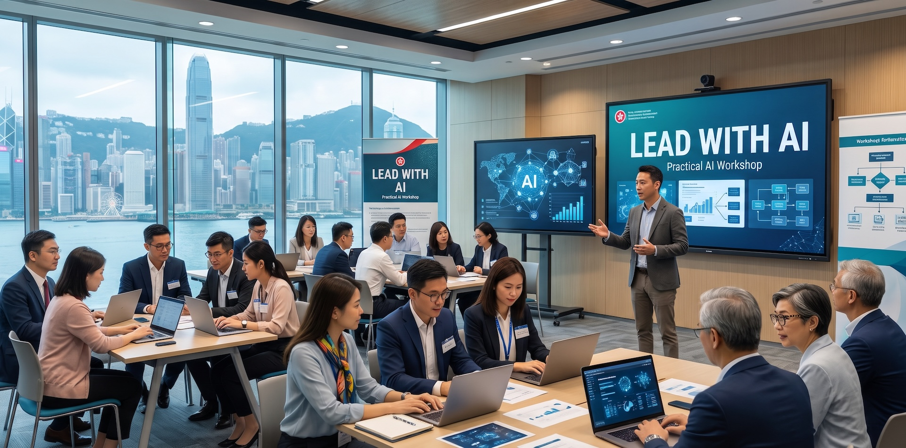
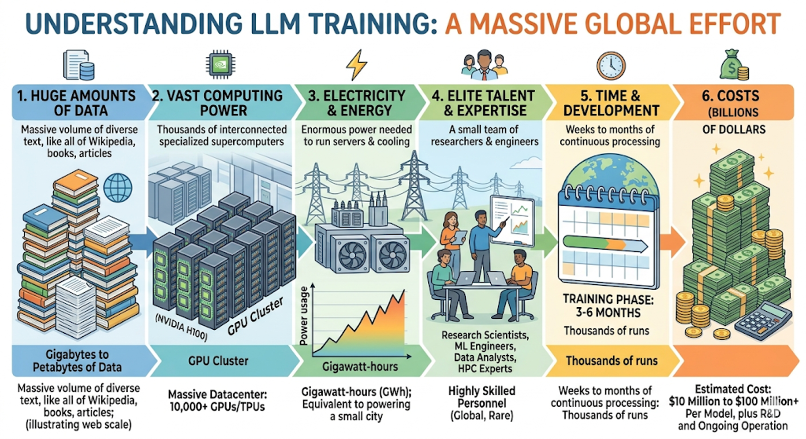
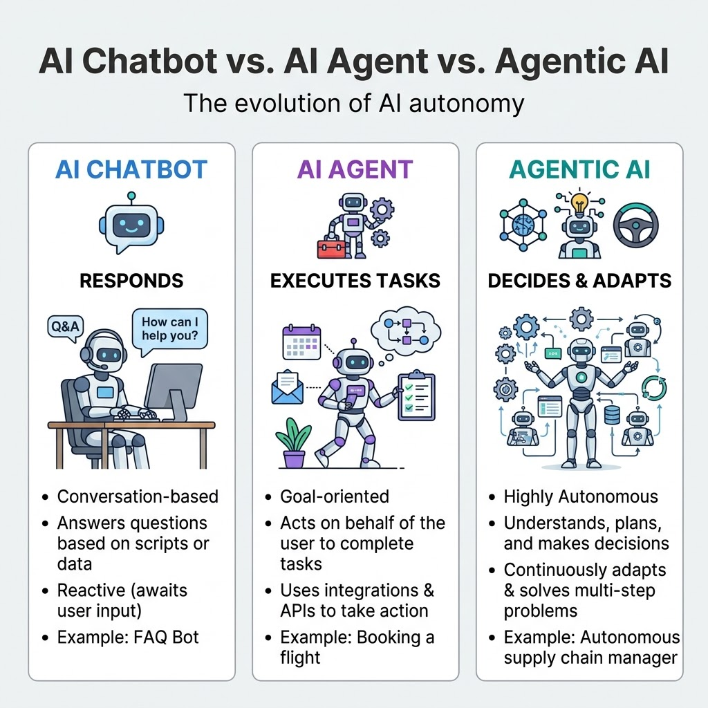
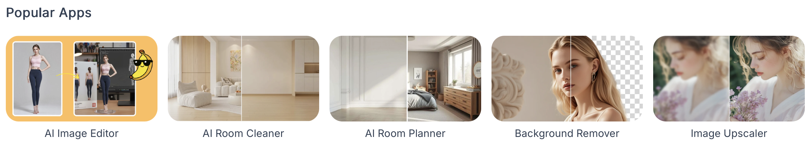
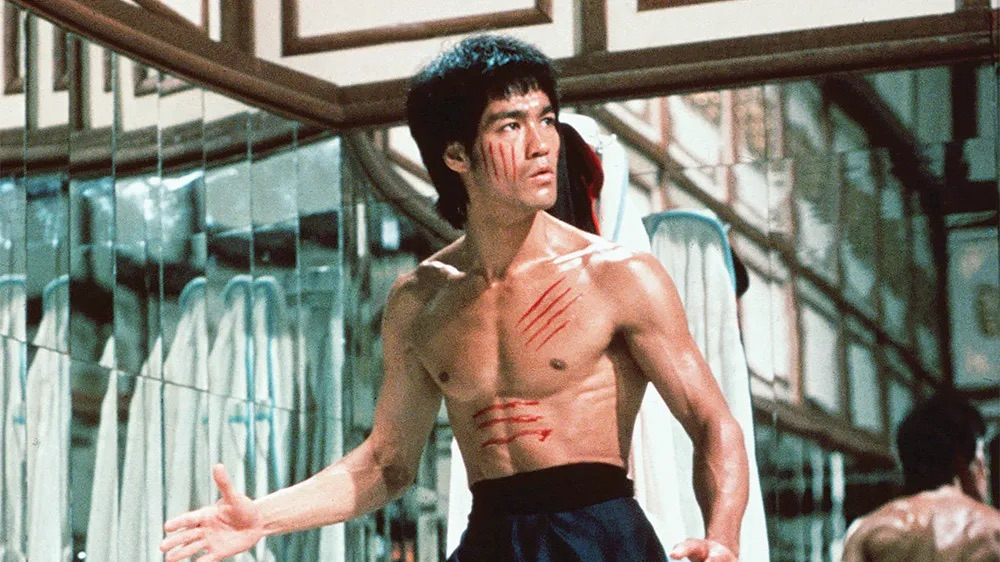
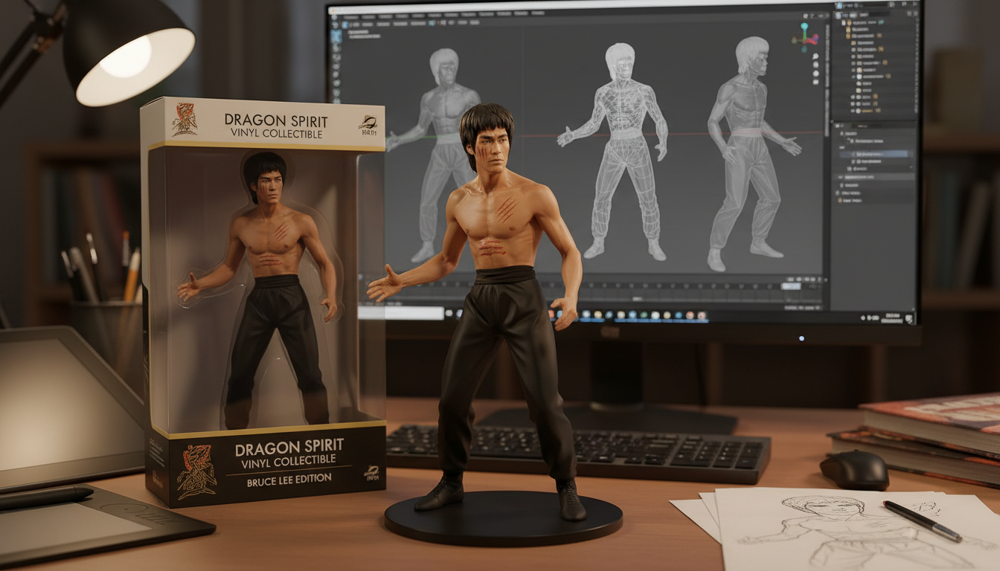
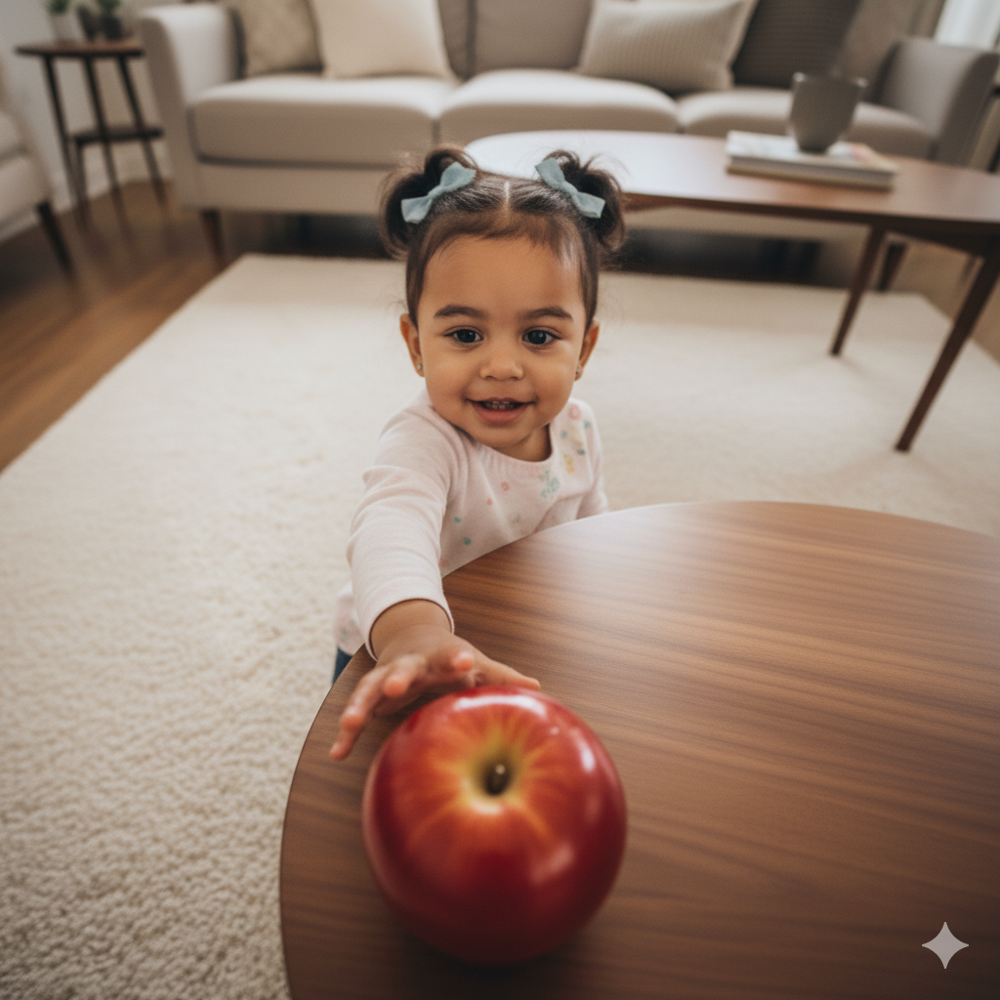
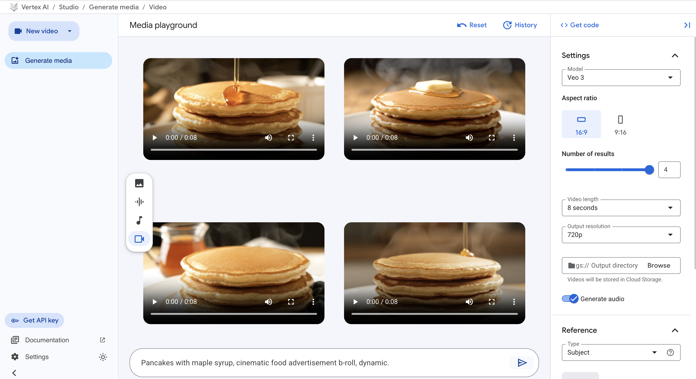
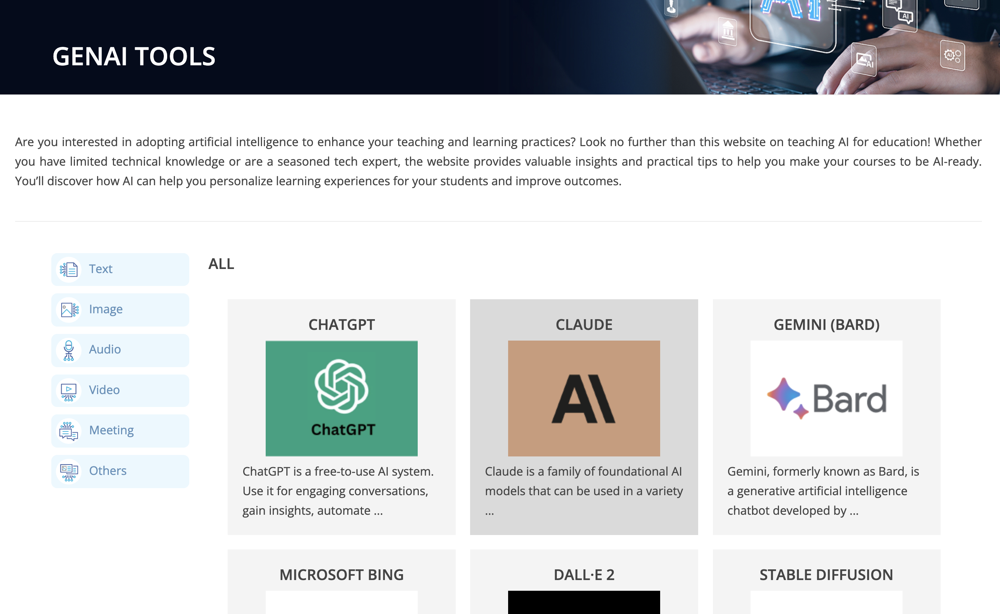

# Lead With AI (2026)



Welcome to **Lead with AI: Leveraging Generative AI Tools and Rewiring How You Work**

# Hello! My Name is Sunny 🌞


**Founder / Developer / Master Trainer** at [Image Nation](https://training.imagenation.com.hk)  
**Part-time Lecturer** at HKU, HKUSPACE, EdUHK  
**Email**: sunny.ng@imagenation.com.hk  
**Trainer Profile**: [https://training.imagenation.com.hk/#sunny-ng](https://training.imagenation.com.hk/#sunny-ng)  
**LinkedIn**: [https://www.linkedin.com/in/ngsunny/](https://www.linkedin.com/in/ngsunny/)

# Useful Keyboard Shortcuts

| Keyboard Shortcut | Description                                          |
| ----------------- | ---------------------------------------------------- |
| `CTRL` + Click    | Open a link in a new browser tab                     |
| `SHIFT` + `ENTER` | Move cursor to next line without sending out prompts |
| `WIN` + `D`       | Show Windows Desktop                                 |
| `CTRL` + `Z`      | Undo last action                                     |
| `CTRL` + `C`      | Copy selected text                                   |
| `CTRL` + `V`      | Paste copied text                                    |

# Tools for Today

It is more effective to keep multiple browser tabs open for different tools.

To open the following AI tools in a **NEW** browser tab, hold `CTRL` (or `CMD` on Mac) when clicking the links below.

- [Gemini](https://gemini.google.com) - Google Gemini is a powerful, multimodal large language model developed by Google that can understand and process a wide range of information, including text, images, audio, video & programming.
- [Microsoft Copilot](https://copilot.microsoft.com/) - Free Microsoft AI assisant.
- [Grok](https://grok.com) - SpaceX AI tool.
- [Qwen](https://chat.qwen.ai) - Conversational AI for various tasks by Alibaba
- [DeepSeek](https://www.deepseek.com) - Conversational AI for various tasks (**NOT** a multi-modal tool)
- [Perplexity](https://www.perplexity.ai) - AI search engine that provides concise answers with sources.
- [Poe](https://poe.com) - Platform to access multiple AI models in one place.
- [VisualGPT](https://visualgpt.io) - Photo Editor with AI / Image Generation
- [Notion AI](https://www.notion.com) - Note-taking and productivity app with AI features.
- [Canva](https://www.canva.com) - Graphic design platform with AI-powered tools. Great for Power Point Generation.
- [Napkin AI](https://www.napkin.ai/) - Visual generation tool.
- [Julius AI](https://julius.ai/) - AI Tools for Excel, Presentations, Websites & More
- [Arena](https://arena.ai/) - Compare and explore different large language models.

# Other Popular AI Tools

- [Microsoft 365 Copilot](https://m365.cloud.microsoft/) - AI assistant integrated into Microsoft 365 apps.
- [Workbuddy](https://workbuddy.ai/) - AI assistant by Tencent for workplace productivity.
- [ElevenLabs](https://elevenlabs.io) - AI-powered text-to-speech platform.
- [narakeet](https://www.narakeet.com/languages/chinese-text-to-speech/) - Easily Create Voiceovers Using Realistic Text to Speech
- [Cleanvoice AI](https://cleanvoice.ai) - Audio editing tool that removes filler words, stutters, and long pauses from audio recordings.
- [Yeri AI](https://yeri.ai/) - Open-source image generation model. Previously known as "Stable Diffusion".
- [Kling AI](https://app.klingai.com) - AI-powered video creation platform.
- [Hailuo AI](https://hailuoai.video) - AI-powered video creation platform.
- [Runway](https://runwayml.com) - AI-powered video editing and creation
- [newarc](https://www.newarc.ai/) - AI-powered fashion creative platform.
- [Tripoai](https://studio.tripo3d.ai) - AI-powered 3D content creation platform.
- [Suno](https://suno.ai/) - AI-powered music generation platform.
- [Lovable](https://lovable.ai/) - AI-powered codes generation platform.

# LLM & Generative AI



- Generative AI is a type of artificial intelligence that can **create new content**, like text, images, or music, in response to prompts from users.
- It uses machine learning models trained on large datasets (**LLM** - **L**arge **L**anguage **M**odels) to generate outputs that mimic human creativity.



# World Popular GenAI Tools

**Source**: [https://a16z.com/100-gen-ai-apps-7/](https://a16z.com/100-gen-ai-apps-7/)

a16z is the short name for Andreessen Horowitz, a major Silicon Valley venture capital (VC) firm founded in 2009 by Marc Andreessen and Ben Horowitz.


# Reminders on Using AI Tools

- AI is NOT always correct.AI sometimes generated false information (known as **hallucination**)
- Free AI tools may collect and use your data to train their models
- Generative AI tools update/evolve rapidly, so features may change and user interfaces may look different
- Human In The Loop (HITL) is important for ensuring the quality and safety of AI-generated content.

# Images Generation Fun

## Using visualgpt.io

[https://visualgpt.io](https://visualgpt.io)

- AI Room Cleaner
- AI Action Figure
- Background Remover



## Once Popular Nano Banana 3D Character Prompt

```
Turn this photo into a character figure.
Behind it, place a figure box with the character image printed on it,
and a computer showing the Blender modeling process on its screen.
In front of the box, add a round plastic base with the figure placed on it.
Use the figure's vinyl material.
Set the scene in home studio
```

**source image:**


**output image:**


## Applying camera language to the prompt

```
a little girl, facing camera, reaching out to an apple on a coffee table.
```


---

```
a little girl, facing camera, reaching out to an apple on a coffee table.
use wide angle effect so that the apple appears very large on screen.
```


---

```
a little girl, facing camera, reaching out to an apple on a coffee table.
top camera view.
```



---

```
a little girl, facing camera, reaching out to an apple on a coffee table.
low camera view.
```


---

## More Tips on Images Generation

[The ultimate Nano Banana prompting guide](https://cloud.google.com/blog/products/ai-machine-learning/ultimate-prompting-guide-for-nano-banana)
[](https://cloud.google.com/blog/products/ai-machine-learning/ultimate-prompting-guide-for-nano-banana)

# Effective Prompting Structure: RICE FACT Framework

| Element                 |     | Description                                                                            |
| ----------------------- | --- | -------------------------------------------------------------------------------------- |
| **R**ole                | →   | Define the role of the AI (e.g., "You are a marketing expert.")                        |
| **I**nstruction/Task    | →   | Specify the goal of the interaction (e.g., "Help me create a marketing plan.")         |
| **C**ontext/Explanation | →   | Provide background information (e.g., "Our target audience is young professionals.")   |
| **E**xamples            | →   | Give examples of desired output (e.g., "Include social media strategies.")             |
| **F**ormat/Layout       | →   | Specify the format of the response (e.g., "Provide a bullet-point list.")              |
| **A**ction/Goal         | →   | Define the action you want the AI to take (e.g., "Generate a 6-month marketing plan.") |
| **C**onstraints         | →   | Set any limitations or requirements (e.g., "Focus on digital channels.")               |
| **T**one/Style          | →   | Indicate the desired tone or style (e.g., "Use a professional and engaging tone.")     |

## Bad Prompt vs. Good Prompt

---

**❌ Bad Prompt**: Too simple. Too generic. DOESN'T include other RICE FACT elements.

```
What is Generative AI?
```

---

**✅ Good Prompt**: Includes A FEW or ALL of the elements above.

| Element                                                   |                  | Example                                                                                                                                                 |
| --------------------------------------------------------- | ---------------- | ------------------------------------------------------------------------------------------------------------------------------------------------------- |
| **R**ole <br>**I**nstruction<br>**C**ontext<br>**F**ormat | →<br>→<br>→<br>→ | Act as a school teacher, <br>explain what Generative AI is <br>to primary school students with little computer knowledge. <br>Use bullet points format. |

---

## Mastering RICE FACT Prompting Framework

Example 1: **Instruction Only**
| Element | | Example |
| ---------------------------------------------------------------------------------------------------------------------- | ------------------------------------ | ------------------------------------------------------ |
| **R**ole <br>**I**nstruction<br>**C**ontext<br>**E**xample<br>**F**ormat<br>**A**ction <br>**C**onstraints<br>**T**one | →<br>→<br>→<br>→<br>→<br>→<br>→<br>→ | <br>Explain what GenAI is.<br><br><br><br><br><br><br> |

---

Example 2: **Role + Instruction**
| Element | | Example |
| ---------------------------------------------------------------------------------------------------------------------- | ------------------------------------ | ------------------------------------------------------ |
| **R**ole <br>**I**nstruction<br>**C**ontext<br>**E**xample<br>**F**ormat<br>**A**ction <br>**C**onstraints<br>**T**one | →<br>→<br>→<br>→<br>→<br>→<br>→<br>→ | You are a secondary teacher.<br>Explain what GenAI is.<br><br><br><br><br><br><br> |

---

Example 3: **Role + Instruction + Context**
| Element | | Example |
| ---------------------------------------------------------------------------------------------------------------------- | ------------------------------------ | ------------------------------------------------------ |
| **R**ole <br>**I**nstruction<br>**C**ontext<br>**E**xample<br>**F**ormat<br>**A**ction <br>**C**onstraints<br>**T**one | →<br>→<br>→<br>→<br>→<br>→<br>→<br>→ | You are a secondary teacher.<br>Explain what GenAI is.<br>The target audience are junior non-ICT students.<br><br><br><br><br><br> |

---

Example 4: **Instruction + Format**
| Element | | Example |
| ---------------------------------------------------------------------------------------------------------------------- | ------------------------------------ | ------------------------------------------------------ |
| **R**ole <br>**I**nstruction<br>**C**ontext<br>**E**xample<br>**F**ormat<br>**A**ction <br>**C**onstraints<br>**T**one | →<br>→<br>→<br>→<br>→<br>→<br>→<br>→ | <br>Explain what GenAI is.<br><br><br>Use one senetence.<br><br><br><br> |

---

Example 5: **Instruction + Format**
| Element | | Example |
| ---------------------------------------------------------------------------------------------------------------------- | ------------------------------------ | ------------------------------------------------------ |
| **R**ole <br>**I**nstruction<br>**C**ontext<br>**E**xample<br>**F**ormat<br>**A**ction <br>**C**onstraints<br>**T**one | →<br>→<br>→<br>→<br>→<br>→<br>→<br>→ | <br>Explain what GenAI is.<br><br><br>Use three bullet points.<br><br><br><br> |

---

Example 6: **Instruction + Format + Contraint**
| Element | | Example |
| ---------------------------------------------------------------------------------------------------------------------- | ------------------------------------ | ------------------------------------------------------ |
| **R**ole <br>**I**nstruction<br>**C**ontext<br>**E**xample<br>**F**ormat<br>**A**ction <br>**C**onstraints<br>**T**one | →<br>→<br>→<br>→<br>→<br>→<br>→<br>→ | <br>Explain what GenAI is.<br><br><br>Use three bullet points.<br><br>Each bullet point not more than 15 words.<br><br> |

---

Example 7: **Instruction + Example**
| Element | | Example |
| ---------------------------------------------------------------------------------------------------------------------- | ------------------------------------ | ------------------------------------------------------ |
| **R**ole <br>**I**nstruction<br>**C**ontext<br>**E**xample<br>**F**ormat<br>**A**ction <br>**C**onstraints<br>**T**one | →<br>→<br>→<br>→<br>→<br>→<br>→<br>→ | <br>Generate 10 dummy customer records as below.<br><br>CustID, CustName, Email, Mobile, Address<br><br><br><br><br> |

---

## Writing Effective Image Generation Prompts

To write effective prompts for images generation, consider the following elements:

- Subject
- Background/Scene
- Adjective
- Style
- Lighting

### Examples: Bad vs. Good

---

**❌ Bad Prompt**: DOESN'T specify any of the elements above.

```
Generate a picture of a cat
```


---

**✅ Good Prompt**: specifies SOME or ALL of the elements above.
| Element | | Example
|----------|----|---------------|
| **Subject** <br>**Background**<br>**Adjective**<br>**Style**<br>**Lighting** | →<br>→<br>→<br>→<br>→| Generate a picture of a cat <br> sitting on a sofa. Behind is a window with open curtain. <br>The cat is white. <br>Make the style realistic. <br>Use dramatic lighting.|


---

# Videos Generation

Video generation tools consume more computing resources and it takes longer time to generate videos.

## Tools

- Google Gemini (Paid Version) (https://gemini.google.com/)
- Google Veo (https://cloud.google.com/vertex-ai/generative-ai/docs/video/overview)
- OpenAI Sora (https://openai.com/sora/)

## Video Generation Demonstration

Use the following prompts

```
Pancakes with maple syrup, cinematic food advertisement b-roll, dynamic.
```

Video Generation Using Veo


## More Video Generation Prompts

```
Hong Kong Causeway Bay, pedestrians walk on busy street, cinematic, dynamic.
```

```
Hong Kong Victoria Harbour at sunset, cinematic,  dynamic.
```

**Tips on Video Generation**:  
One must master visual language to write effective prompts for video generation. Here are some useful resources to learn visual language.

[Video generation prompt guide](https://cloud.google.com/vertex-ai/generative-ai/docs/video/video-gen-prompt-guide?hl=en)  
[Seedance Prompt Builder](https://seedancee.com/seedance-prompts)

# Photo / Video / Icon Libraries

Images/Video generation tools cloud end up being slow and expensive. Sometimes, it is more efficient to use free stock photo/video/icon libraries.

- [Unsplash](https://unsplash.com) - Free high-quality photos.
- [Pexels](https://www.pexels.com) - Free stock photos and videos.
- [Magnific](https://www.magnific.com/) - Free vectors, stock photos, PSD, and icons.
- [Icons8](https://icons8.com) - Free icons and images.
- [Flaticon](https://www.flaticon.com) - Free icons in various formats.

# HKU Suggested GenAI Tools

[GenAI Tools Listing for Teaching & Learning](https://aied.talic.hku.hk/genaitools/)

[](https://aied.talic.hku.hk/genaitools/)
